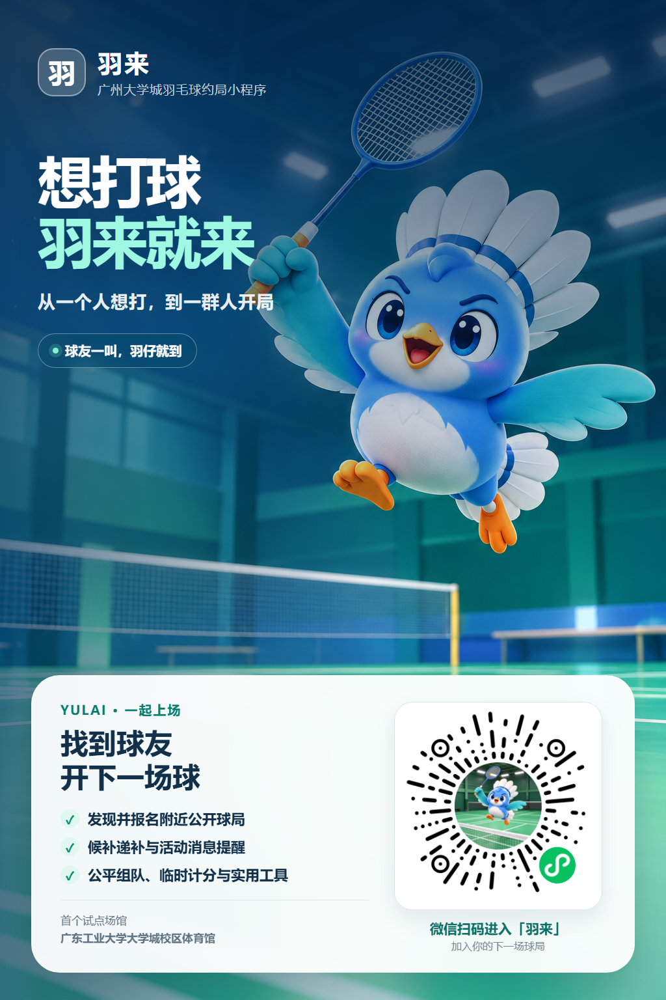

# 羽来 Yulai

[](https://github.com/veda-chen/Yulai-miniapp/actions/workflows/ci.yml)
[](LICENSE)

羽来是面向广州大学城羽毛球爱好者的微信组局小程序。它以公开组局为主流程，帮助球友发现和创建球局、报名或候补，并按需启用现场组队与计分。

项目正在准备试点体验版。场馆列表包含广东工业大学大学城校区体育馆和华南理工大学大学城校区体育馆，两处场馆的现场资料仍待核验。M1–M4 功能与 M5 自动化基线已经完成，微信公众平台隐私保护指引已配置。本轮[全面优化实施记录](docs/全面优化实施记录_2026-10-11.md)汇总了页面、正确性、性能和发布改动。正式上线仍需完成平台与生产环境配置、场馆现场核验、Android／iOS 真机验收、云端并发和备份恢复演练。

四个核心页面的 [UI 升级对比原型](design/ui-refresh-v1/README.md) 可在浏览器体验，原型使用示例数据。小程序保留“首页／工具／场馆／我的”四个底部入口和照片封面，轻玻璃效果集中在导航与固定操作栏。[实际小程序模拟器截图](docs/下一轮体验优化验收记录_2026-10-09.md)属于 10 月 9 日版本；当前工作区的视觉与真机验收仍需重新执行。

## 宣传海报

<a href="marketing/yulai-promo-poster-v1.png"></a>

[查看原尺寸海报](marketing/yulai-promo-poster-v1.png)。小程序仍处于试点准备阶段，扫码体验权限以微信平台设置为准。

## 功能

- **发现与组局**：浏览公开球局，按北京时间日期、场馆、水平和余位组合筛选；创建、编辑、取消和结束活动。创建时可复制本人上次球局的可复用内容，并在发布前核对摘要
- **打球鸭邀请卡**：选择文案并创建可转发到微信聊天的邀请卡，球友可回应打球意向；它不代替正式球局报名
- **独立工具**：无需创建球局即可使用公平组队、临时计分、费用均摊和规则速查；公平组队采用逐人录入和批量粘贴，按到场人数生成同等数量的双打场次，每人固定上场 4 次，5 人及以上时每次搭档均不同
- **报名与候补**：报名、退出、候补、截止后人工递补、到场状态管理
- **个人资料**：维护昵称、可选头像、羽毛球水平和可选学校信息，查看参加过的球局、本人近期球局数量和战绩；各项数据独立加载
- **个性化设置**：优先选择蓝、绿、橙三套风格预设并预览；明暗和字号作为基础选项，其余页面背景、卡片、按钮、动效、首页布局与云同步等设置收在高级区。手工修改后显示“自定义”
- **消息通知**：站内通知，以及报名候补、递补、球局变更和取消的微信订阅消息
- **场馆信息**：展示地址、入口、开放说明、设施、封面、平面图和核验状态
- **运营管理**：维护场馆资料，处理举报、下架球局、限制账号并记录审计日志
- **现场模式（可选）**：整轮双打分组、手工创建单打或双打对局、参与者录分、比分确认与战绩

组队和计分不会成为创建球局的必选步骤。项目当前不提供线上支付、订单、退款或平台收款能力。

## 技术架构

| 层级 | 技术 |
| --- | --- |
| 小程序端 | 微信原生小程序、TypeScript、WXML、WXSS |
| 服务端 | 微信云开发 CloudBase、Node.js、TypeScript |
| 数据与鉴权 | CloudBase 数据库、`wx.cloud.callFunction`、`getWXContext` |
| 工程化 | pnpm workspace、Biome、Vitest、GitHub Actions |

小程序统一调用 `api` 云函数。服务端从微信上下文获取可信用户身份，客户端不提交 `openid`；业务集合保持仅管理员直连，普通用户通过云函数访问数据。联系方式权限、账号状态、报名容量和通知发送状态由服务端判断；入口日志只记录脱敏动作、结果、耗时与请求编号。

## 项目结构

```text
.
├─ apps/miniprogram/       # 微信原生小程序
│  ├─ components/          # 项目内可复用 UI 组件
│  └─ pages/tools/         # 无需创建球局的本地快捷工具
├─ cloudfunctions/api/     # 模块化云函数 API
├─ cloudbase/              # 集合、索引、安全规则和种子数据
├─ marketing/              # 宣传海报和小程序码素材
├─ packages/shared/        # 跨端共享类型与契约
├─ scripts/                # 构建、部署、备份和里程碑校验脚本
├─ release/                # M5 发布门槛与性能结果
└─ docs/                   # 产品、架构、运营和验收文档
```

## 本地运行

### 环境要求

- [Node.js](https://nodejs.org/) 22 或更高版本
- [pnpm](https://pnpm.io/) 11
- [微信开发者工具](https://developers.weixin.qq.com/miniprogram/dev/devtools/download.html)
- 已开通微信云开发的小程序账号和 CloudBase 环境

### 1. 安装依赖

```bash
pnpm install --frozen-lockfile
```

### 2. 配置云开发

```powershell
Copy-Item .env.example .env
```

填写 `.env`：

```dotenv
CLOUDBASE_ENV_ID=your-development-environment-id
DEVELOPMENT_CLOUDBASE_ENV_ID=your-development-environment-id
TRIAL_CLOUDBASE_ENV_ID=your-trial-environment-id
PRODUCTION_CLOUDBASE_ENV_ID=your-production-environment-id
OPENID_HASH_SECRET=your-random-secret-at-least-32-characters
SUBSCRIPTION_OPENID_KEY=another-random-secret-at-least-32-characters
WECHAT_MINIPROGRAM_STATE=developer
RELEASE_VERSION=
```

本地开发可沿用 `.env.example` 的开发环境 ID；体验版必须显式填写 `TRIAL_CLOUDBASE_ENV_ID`，试点联调时可指向开发云环境，正式版必须显式配置生产环境 ID；已有正式版数据时须指向存放这些数据的现有环境，切换到独立环境前应先完成迁移。`WECHAT_MINIPROGRAM_STATE` 可设为 `developer`、`trial` 或 `formal`；体验版云函数发送订阅消息前应设为 `trial` 并重新部署。`RELEASE_VERSION` 仅在正式部署时填写，并须与 `package.json` 一致。安装依赖或构建时会生成被 Git 忽略的客户端环境配置。`.env` 包含本地部署密钥，不应提交到 Git。

检查配置并构建：

```bash
pnpm cloud:check
pnpm build
```

首次创建集合、索引和种子数据时，按照 [CloudBase 初始化说明](cloudbase/SETUP.md) 操作。已有环境升级前，还需按说明创建统计／通知索引、`fileCleanupJobs`、`playInvitations`、`playInvitationReplies` 和 `appearancePreferences` 集合，确认权限为 `ADMINONLY`，再部署兼容的云函数。开发环境部署命令：

```bash
pnpm cloud:deploy
```

体验版上传顺序：先配置体验版环境 ID，执行 `pnpm check` 和 `pnpm build`；再确认目标环境的集合、索引与新版 `api` 云函数已部署，至少检查 `health.get` 和 `invitation.get` 的路由；最后用微信开发者工具上传代码，并在微信公众平台将该开发版本设为体验版。仅执行开发者工具的“上传”不会自动完成“设为体验版”。体验版用于联调，不代表[正式发布门槛](release/m5-gates.json)已经通过。

### 3. 打开小程序

使用微信开发者工具导入仓库根目录。工具会读取 `project.config.json`，小程序源码目录为 `apps/miniprogram/`，云函数目录为 `cloudfunctions/`。

如果在自己的小程序账号下运行，请将 `project.config.json` 中的 `appid` 改成对应 AppID，并确保所选云环境与 `.env` 一致。

## 常用命令

| 命令 | 用途 |
| --- | --- |
| `pnpm build` | 构建全部工作区包 |
| `pnpm test` | 运行自动化测试 |
| `pnpm typecheck` | 执行 TypeScript 类型检查 |
| `pnpm lint` | 执行 Biome 静态检查 |
| `pnpm format` | 格式化项目文件 |
| `pnpm check` | 运行格式、Lint、类型、测试、UI 行为和 M1–M5 自动校验 |
| `pnpm cloud:check` | 检查本地 CloudBase 配置 |
| `pnpm cloud:deploy` | 构建并部署 `api` 云函数；触发器配置按 CloudBase 说明核验 |
| `pnpm performance:cloud -- 20 5` | 对公开云接口执行受控性能测试 |
| `pnpm backup:cloud` | 将业务集合备份到本地忽略目录 |
| `pnpm restore:plan -- --time "YYYY-MM-DD HH:mm:ss"` | 生成平台回档到隔离集合的演练计划 |
| `pnpm restore:json-plan -- --backup <目录> --target-env <环境ID>` | 校验 JSON 备份并生成隔离导入清单 |
| `pnpm release:snapshot` | 记录代码、云函数产物、索引定义和发布门槛的映射 |
| `pnpm release:check` | 执行完整候选版检查和人工发布门槛校验 |
| `pnpm cloud:deploy:release` | 发布门槛、生产环境及版本检查通过后部署云函数 |

正式发布前运行 `pnpm check`、`pnpm build`、`pnpm release:snapshot`，将生成的本地清单与微信上传版本、Git 提交、云函数产物和索引变更对应保存。`pnpm release:check` 会继续校验[六项发布门槛](release/m5-gates.json)；门槛未全部通过时不会放行正式部署。JSON 恢复清单只生成导入计划，不能代替隔离环境的真实恢复演练；操作步骤见[备份与恢复手册](docs/CloudBase备份与恢复手册.md)。

## 当前进度

- [x] M1：工程基线与微信云开发接入
- [x] M2：用户、学校、场馆、球局、报名和候补基础流程
- [x] M3：活动运营、站内通知、正式订阅消息、举报和管理能力
- [x] M4：可选分组、参与者计分、确认和战绩能力
- [x] M5：自动候选版基线、CI、备份脚本、性能脚本和发布门槛
- [x] 场馆核验资料、封面和平面图的管理员维护页面
- [x] 全局个性化组件 V4、首页工具选择与可选云同步
- [x] 四项本地工具扩展及 7 天自动清理机制
- [x] 我的球局独立加载、列表分页与服务端搜索、创建草稿恢复、消息容错和外观同步重试
- [x] 核心流程体验打磨：可信首页搜索、真实未读提示、球局状态反馈和字段级创建校验
- [x] 核心细节精修：搜索响应隔离、持续操作反馈、安全发布跳转及小屏布局优化
- [x] 全局体验提升：逐行参与者录入、筛选重置、场馆重试、资料脏状态及表单字段反馈
- [x] 全面优化本地改动：外观预设优先、请求状态保护、报名与注销并发检查、通知重试、统计修正和环境发布检查
- [x] 首页新版布局、“打球鸭”互动邀请卡和分享封面、个人资料趣味水平选项
- [x] 华南理工大学大学城校区体育馆加入场馆种子数据，状态保持待核验
- [x] 微信公众平台隐私保护指引已配置
- [ ] 当前版本的多尺寸视觉截图、Android／iOS 真机主流程、订阅消息与云端并发验收
- [ ] 历史稳定游标分页、历史列表增量更新及优化前后 P95 对比
- [ ] 微信公众平台其他项目与生产环境最终配置
- [ ] 广东工业大学大学城校区体育馆现场资料核验
- [ ] 根据实际套餐能力完成平台回档或 JSON 导入的隔离恢复演练

M5 的人工门槛和证据记录在 [`release/m5-gates.json`](release/m5-gates.json)。截至 2026-10-15，仍有五项 `PENDING`、一项 `BLOCKED`。门槛未全部通过时，`pnpm release:check` 会失败，以阻止把体验候选版误判为可正式发布版本。

## 文档

- [产品需求文档](docs/羽来PRD_V0.1.md)
- [项目章程与 V1 范围](docs/项目章程与V1需求范围_V0.1.md)
- [技术架构与开发排期](docs/羽来技术架构设计和开发排期_V0.1.md)
- [微信云开发架构决策](docs/ADR-001-采用微信云开发.md)
- [M3 运营与通知模块](docs/M3运营与通知模块.md)
- [M4 可选现场功能](docs/M4可选现场功能.md)
- [M5 试点候选版](docs/M5试点候选版.md)
- [微信订阅消息接入说明](docs/微信订阅消息接入说明.md)
- [隐私与微信审核清单](docs/隐私与微信审核清单.md)
- [试点场馆核验表](docs/试点场馆核验表.md)
- [CloudBase 备份与恢复手册](docs/CloudBase备份与恢复手册.md)
- [个性化设置开发计划](docs/羽来自定义UI组件与外观设置计划_V0.1.md)
- [首页与个性化设置 UI 优化验收记录](docs/首页与个性化设置UI优化验收记录_2026-09-18.md)
- [全局个性化组件 V3 验收记录](docs/全局个性化组件V3验收记录_2026-09-18.md)
- [工具箱扩展与个性化设置 V4 验收记录](docs/工具箱扩展与个性化设置V4验收记录_2026-09-19.md)
- [公平组队工具验收记录](docs/公平组队工具验收记录_2026-09-29.md)
- [全局用户体验提升验收记录](docs/全局用户体验提升验收记录_2026-09-29.md)
- [全局可靠性优化验收记录](docs/全局可靠性优化验收记录_2026-09-19.md)
- [核心流程体验打磨验收记录](docs/核心流程体验打磨验收记录_2026-09-19.md)
- [全面优化实施记录](docs/全面优化实施记录_2026-10-11.md)

## 隐私与数据

学校信息和头像均为可选项。尚未发布的球局草稿及临时计分、公平组队和费用数据只保存在当前设备，7 天后自动过期；发布成功、手动清理或注销账号时会按对应场景清除。用户可以清空可选资料或注销账号；注销后个人展示信息会匿名化，最小账号关联信息按项目留存规则定期清理。相册、相机和订阅消息等能力必须与微信公众平台隐私保护指引中的实际声明保持一致。

## 许可证

本项目采用 [MIT License](LICENSE)。

### 上传前云环境检查

每次使用微信开发者工具上传前，先运行 `pnpm upload:prepare`。同一个上传包会从体验版进入正式版，因此 `TRIAL_CLOUDBASE_ENV_ID` 和 `PRODUCTION_CLOUDBASE_ENV_ID` 都必须填写；缺少任何一个都会阻止准备上传。环境配置仅在本地生成，不包含在 Git 中。普通 CI 检查通过不能代替这一步。

2026-10-15 修复：正式版环境 ID 为空会导致启动时未执行云初始化，表现为个人资料、场馆和球局同时加载失败。0.2.11 修复上传配置，并将云初始化放入 `App.onLaunch`，增加三种版本的启动回归检查。已发布的旧包需要发布修复版本，重部署云函数不能修复客户端配置。
